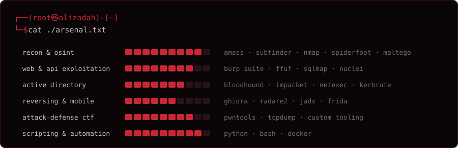

<p align="center">
  
</p>

<p align="center">
  
  
  
  
</p>

---

### `└─$ whoami --verbose`

```bash
# offensive security · Azerbaijan

NAME ......... Yusif Alizadeh
ALIAS ........ alizadah
ROLE ......... penetration tester / security researcher / osint analyst
FOCUS ........ web & api exploitation, active directory, recon, attack-defense ctf
MINDSET ...... map the surface, find the one assumption nobody tested, prove impact
RULES ........ authorized scope only. findings get reported, not kept.
```

I break into things so the people who own them find out before someone else does.
Day to day that means web and API assessments, Active Directory attack paths,
reverse engineering, and OSINT — turning scattered public traces into a target profile.
Off the clock it is attack-defense CTF, where you patch your own service while
farming flags from everyone else's.

---

### `└─$ cat ./arsenal.txt`

<p align="center">
  
</p>

<p align="center">
  
  
  
  
  
  
  
  
  
  
  <br>
  
  
  
  
  
  
  
</p>

---

### `└─$ ./stats --theme=dark`

<p align="center">
  
</p>

---

### `└─$ cat ./contact`

<p align="center">
  
  <a href="https://tryhackme.com/p/alizadex"></a>
</p>

---

<p align="center">
  <sub><code>Everything here is built for authorized testing, CTFs and research. Scope first, exploit second, report always.</code></sub>
</p>

<p align="center">
  <sub><code>└─$ exit</code> &nbsp;·&nbsp; <code>connection closed.</code></sub>
</p>
