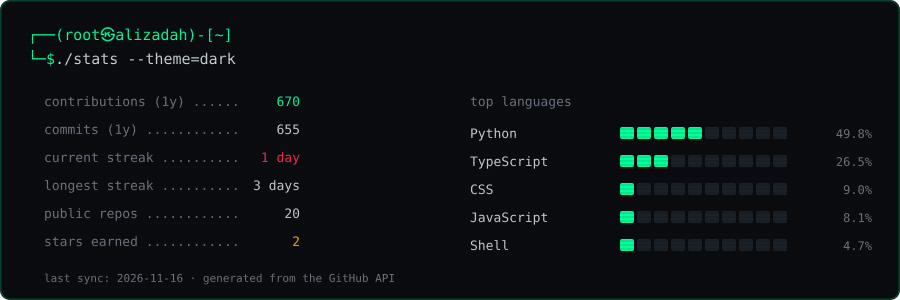

<p align="center">
  
</p>

<p align="center">
  
  
  
  
</p>

---

### `└─$ whoami --verbose`

```bash
# offensive security · Azerbaijan

NAME ......... Yusif Alizadeh
ALIAS ........ alizadah
ROLE ......... penetration tester / security researcher / osint analyst
FOCUS ........ web & api exploitation, active directory, recon, attack-defense ctf
MINDSET ...... map the surface, find the one assumption nobody tested, prove impact
RULES ........ authorized scope only. findings get reported, not kept.
```

I break into things so the people who own them find out before someone else does.
Day to day that means web and API assessments, Active Directory attack paths,
reverse engineering, and OSINT — turning scattered public traces into a target profile.
Off the clock it is attack-defense CTF, where you patch your own service while
farming flags from everyone else's.

---

### `└─$ cat ./arsenal.txt`

<p align="center">
  
</p>

<p align="center">
  
  
  
  
  
  
  
  
  
  
  <br>
  
  
  
  
  
  
  
</p>

---

### `└─$ ls -la ./operations/`

| | operation | brief |
|---|---|---|
| `▸` | **[redrizz](https://github.com/YusifAlizadeh/redrizz)** | Attack-Defense CTF red-team toolkit — exploit farm, flag submitter, traffic steal & replay, SLA checker |
| `▸` | **[privcheat](https://github.com/YusifAlizadeh/privcheat)** | Privilege-escalation reference and enumeration helper for Linux post-exploitation |
| `▸` | **[rizzarch](https://github.com/YusifAlizadeh/rizzarch)** | Offensive-ready Arch workstation provisioning — tooling, hardening, reproducible setup |
| `▸` | **[reverse_engineering](https://github.com/YusifAlizadeh/holbertonschool-reverse_engineering)** | Binary analysis, disassembly and ELF internals |
| `▸` | **[mobile_security](https://github.com/YusifAlizadeh/holbertonschool-mobile_Security)** | Android app assessment — APK analysis, pinning bypass, mobile API testing |
| `▸` | **[cyber_security](https://github.com/YusifAlizadeh/holbertonschool-cyber_security)** | Network security, cryptography and defensive fundamentals |

---

### `└─$ ./stats --theme=dark`

<p align="center">
  
</p>

---

### `└─$ cat ./contact`

<p align="center">
  
  <a href="https://tryhackme.com/p/alizadex"></a>
</p>

---

<p align="center">
  <sub><code>Everything here is built for authorized testing, CTFs and research. Scope first, exploit second, report always.</code></sub>
</p>

<p align="center">
  <sub><code>└─$ exit</code> &nbsp;·&nbsp; <code>connection closed.</code></sub>
</p>
